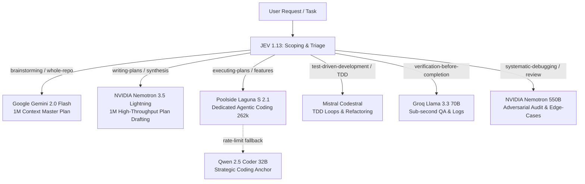

# Compute Engines & Models Registry (Antigravity & OpenCode)

This registry orchestrates the LLM compute engines configured for Abdo's engineering growth workspace, routing tasks based on cost efficiency, rate limits, latency, and context window size across all free tiers.

---

## 1. Active Configured Free Engines (Hybrid Routing Matrix v2.1)

| Model | Provider | Context Window | Free Tier Limits | Primary Superpowers Role |
| :--- | :--- | :--- | :--- | :--- |
| **Poolside Laguna S 2.1** | OpenRouter / Poolside | 262,144 tokens | 20 RPM / 200 RPD | **Primary Dedicated Coding Agent & Fullstack Feature Implementation (118B / 8B Active MoE)** |
| **NVIDIA Nemotron 3.5 Lightning** | OpenRouter / NVIDIA | 1,000,000 tokens | 30 RPM / 1000 RPD | **High-Throughput 1M Context Synthesis & Implementation Plan Drafting (30B / 3B Active MoE)** |
| **Qwen 2.5 Coder 32B** | OpenRouter / Qwen | 131,072 tokens | 20 RPM / 200 RPD | **Strategic Secondary Fallback for Heavy Fullstack TS/React Code Generation** |
| **MiniMax-01** | OpenCode / MiniMax | 1,000,000 tokens | 30 RPM / 1000 RPD | **Strategic Secondary Fallback for Long-Context Synthesis** |
| **NVIDIA Nemotron 3 Ultra 550B** | OpenRouter / NVIDIA | 131,072 tokens | 20 RPM / 100 RPD | **Deep Security, Concurrency, Edge-Cases & Adversarial Code Review** |
| **JEV 1.13 (Deterministic)** | OpenCode | 65,536 tokens | 60 RPM / 5000 RPD | **Zero-Cost Task Classification, Scoping & Dependency Triage** |
| **Mistral Codestral 2501** | Mistral AI | 128,000 tokens | 30 RPM / 1 RPS / 500k TPM | **TDD Loops, Subagent Unit Testing & Refactoring** |
| **Google Gemini 2.0 Flash** | Google AI Studio | 1,048,576 tokens | 15 RPM / 1500 RPD / 1M TPM | **Whole-Repo Scanning, Brainstorming & Supreme Orchestration** |
| **Groq Llama 3.3 70B Versatile** | Groq Cloud | 128,000 tokens | 30 RPM / 14,400 RPD | **Sub-Second Linting, Test Log Screening & Verification Before Completion** |

---

## 2. Superpowers Task Routing Matrix (v2.1)

Each Superpowers protocol is routed to the engine best suited for its cognitive demand and rate constraints:

---

## 3. Strict Multi-Agent Rules

1. **Zero Unnecessary Token Waste**:
   - Small inline edits and terminal tasks go to JEV or Codestral.
   - Large architectural synthesis goes to Gemini or Nemotron 3.5 Lightning due to massive context windows and MoE throughput.
   - Sub-second assertions and test logs go to Groq.
2. **Evidence Before Assertions**:
   - Regardless of which model drafted the code, Groq / Codestral must verify exit code 0 via `run_command` before any completion claim.
