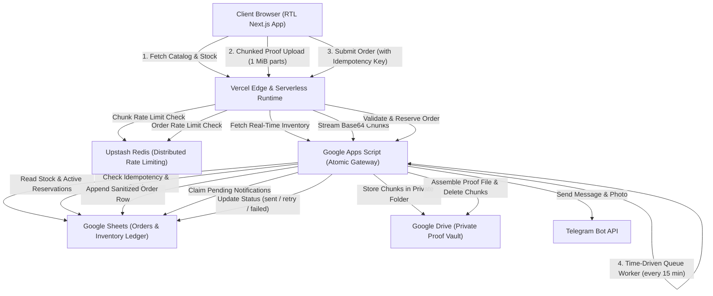
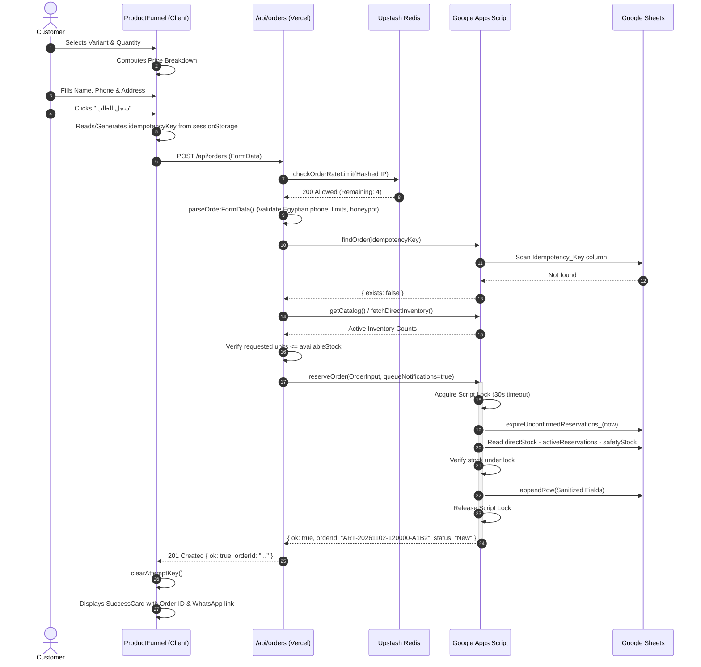
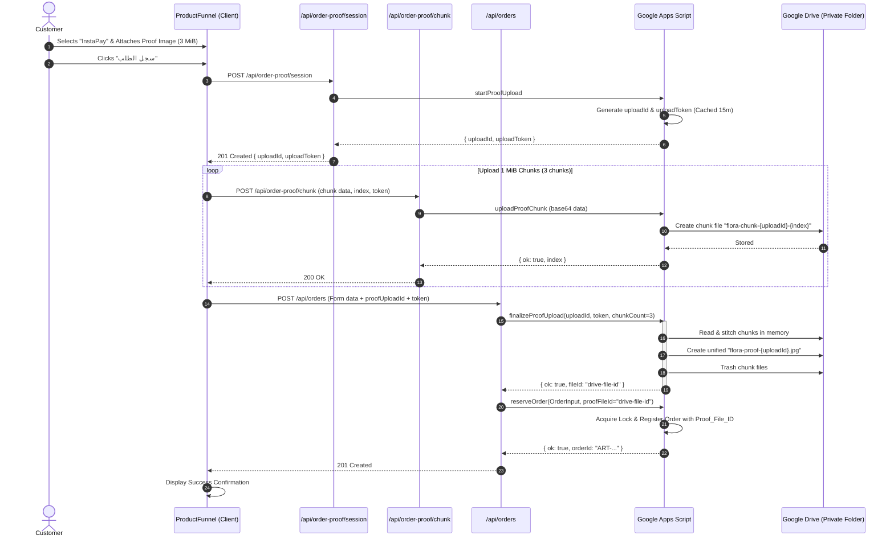
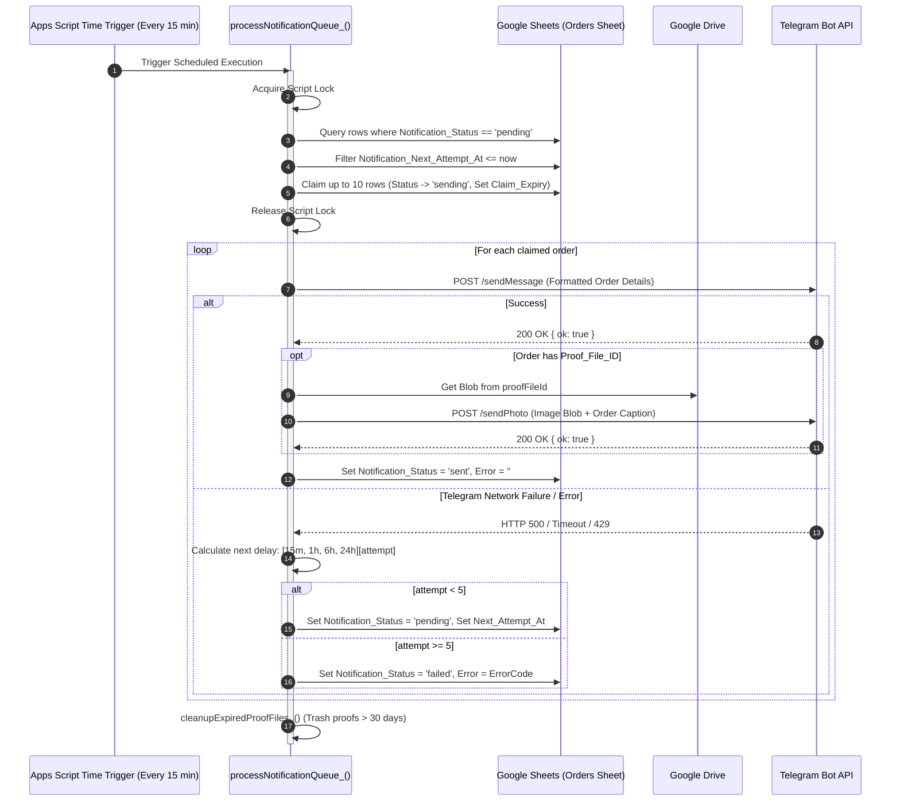
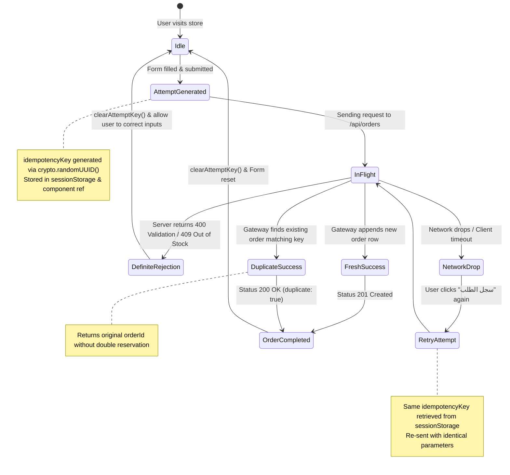

# PR: Production-Grade Direct-to-Consumer Funnel & Atomic Reservation Ledger

> **Repository**: `growth-workspace-withAI`
> **Subsystem**: `local-business-store/flora-home-online-store`
> **Target Branch**: `main`
> **PR Type**: `Feature & Architectural Hardening`
> **Author**: Abdullah Mahmoud Fawzy & Blue

---

## 1. Executive Summary

This Pull Request transitions the Flora Home direct-to-consumer (D2C) store from a prototype into an enterprise-grade, ad-ready sales funnel. The system is engineered to handle paid advertising traffic with zero inventory corruption, zero leaked stock between D2C and Amazon FBA, resilient multipart proof ingestion under Vercel serverless constraints, distributed HMAC-hashed rate limiting, formula injection prevention, and asynchronous notification delivery with exponential backoff.

### Core Metrics & Capabilities
- **Serverless Resilience**: 100% multipart chunking for payment proofs, bypassing Vercel's 4.5 MB request body limit.
- **Ledger Concurrency**: Atomic spreadsheet locking (`LockService.getScriptLock(30000)`) preventing overselling and phantom stock.
- **Stock Model**: Cumulative allocation accounting with permanent consumption for confirmed/shipped orders and 24-hour TTL for unconfirmed reservations.
- **Privacy & Rate Limiting**: Distributed Upstash Redis sliding window with HMAC-SHA256 hashed identifiers failing closed in production.
- **Spreadsheet Security**: Strict CSV/Spreadsheet formula sanitization for all customer text inputs (`=`, `+`, `-`, `@`).
- **Notification Reliability**: Decoupled asynchronous queue in Google Apps Script with exponential backoff (`[15m, 1h, 6h, 24h]`, 5 max attempts).

---

## 2. System Architecture & High-Level Data Flow



---

## 3. Detailed Component & Method Specifications

### 3.1 Domain Logic & Pricing Layer (`lib/pricing.ts`)

#### `calculatePricing(selection, pricing, paymentMethod): PriceBreakdown`
- **Purpose**: Computes bundle subtotal, tiered discounts, delivery fee, and prepaid discounts.
- **Lifecycle**:
  1. Sums total units across variants (`bubble`, `diamond`, `fluted`).
  2. If `totalUnits === 0`, returns zeroed breakdown.
  3. Applies bundle pricing tiers:
     - 1 unit: Single price (`D2C_SINGLE_PRICE`).
     - 2 units: Two-pack bundle price (`D2C_TWO_PRICE`).
     - 3+ units: Three-pack base price (`D2C_THREE_PRICE`) plus incremental units (`D2C_ADDITIONAL_UNIT_PRICE`).
  4. Evaluates free shipping threshold (`totalUnits >= freeShippingThreshold ? 0 : shippingFee`).
  5. Evaluates prepaid discount (`paymentMethod === 'InstaPay' ? prepaidDiscount : 0`).
  6. Computes `total = Math.max(0, productSubtotal + shipping - prepaidDiscount)`.

---

### 3.2 Store Configuration Layer (`lib/store-config.ts`)

#### `getStoreSettings(): StoreSettings`
- **Purpose**: Centralizes operational settings with environment variable fallbacks.
- **Inputs**: Server environment (`INSTAPAY_IDENTIFIER`, `INSTAPAY_RECIPIENT`, `SUPPORT_WHATSAPP`, `DELIVERY_ESTIMATE`, `INSTAPAY_PROOF_REQUIRED`).
- **Outputs**: Strongly typed `StoreSettings` object injected into the public catalog.

#### `normalizeWhatsappNumber(value): string`
- **Purpose**: Normalizes Egyptian phone numbers into an international WhatsApp dialing string (`201xxxxxxxx`).
- **Lifecycle**:
  1. Strips all non-digit characters (`\D`).
  2. Trims leading `0020` to `20`.
  3. Prepend `20` if starting with single `0`.
  4. Returns clean E.164-compatible recipient string.

---

### 3.3 Validation & Security Normalization Layer (`lib/validation.ts`)

#### `normalizeEgyptianPhone(value): string`
- **Purpose**: Strips formatting noise, spaces, dashes, and international prefixes from Egyptian mobile inputs.
- **Lifecycle**: Converts Eastern Arabic numerals (`٠-٩`) to Western numerals (`0-9`), removes non-digits, and strips leading `0020` or `20`, returning a standard 11-digit string (`01xxxxxxxxx`).

#### `parseOrderFormData(formData, options): ParsedOrder`
- **Purpose**: Validates all customer inputs before hitting domain or gateway services.
- **Lifecycle**:
  1. **Honeypot Evaluation**: Rejects immediately if hidden `website` field contains data.
  2. **Idempotency Key Verification**: Enforces UUID/alphanumeric regex (`^[a-zA-Z0-9_-]{16,100}$`).
  3. **Field Length Bounds**: Enforces limits (`customerName <= 120`, `addressDetails <= 1000`, `source <= 100`).
  4. **Geographic Gate**: Allows only `Cairo` and `Giza`.
  5. **Phone Validation**: Checks normalized number against `/^01[0-25-9][0-9]{8}$/`.
  6. **Payment Validation**:
     - Ensures valid method (`COD` or `InstaPay`).
     - If `InstaPay`, checks if configured on the server, verifies a 4-digit reference code (`/^\d{4}$/`), and enforces proof requirements if configured.
  7. **Proof Upload Metadata**: Validates session upload ID, token, chunk count (`1-5`), and MIME type (`image/*`).
  8. **Unit Quantities**: Confirms total units > 0 and quantities are non-negative integers.

---

### 3.4 Rate Limiting & Identity Protection (`lib/rate-limit.ts`)

#### `hashRateLimitIdentifier(clientKey, secret): string`
- **Purpose**: Anonymizes client IP addresses before transmitting to third-party distributed storage.
- **Mechanism**: `createHmac('sha256', secret).update(clientKey).digest('hex')`.

#### `createOrderRateLimiter(dependencies)`
- **Purpose**: High-order rate limiter supporting Upstash Redis in production and an in-memory sliding window in development.
- **Production Posture**: Fail-closed (`RateLimitUnavailableError` resulting in HTTP 503) if Upstash is unreachable or unconfigured.

#### Scoped Rate Limiters:
- `checkOrderRateLimit(clientKey)`: 5 requests per 10 minutes.
- `checkProofSessionRateLimit(clientKey)`: 10 sessions per 10 minutes.
- `checkProofChunkRateLimit(clientKey)`: 30 chunk uploads per 10 minutes.

---

### 3.5 Bounded Streaming & Memory Protection (`lib/request-body.ts`)

#### `readBoundedBytes(request, maxBytes): Promise<Uint8Array>`
- **Purpose**: Reads request body streams in chunks while enforcing hard byte limits to prevent denial-of-service memory exhaustion.
- **Lifecycle**:
  1. Reads `Content-Length` header; if larger than `maxBytes`, throws `RequestBodyTooLargeError` before reading.
  2. Obtains reader via `request.body.getReader()`.
  3. Accumulates chunks in an array; if accumulated bytes exceed `maxBytes`, cancels stream and releases lock.
  4. Concatenates chunks into an exact-sized `Uint8Array`.

#### `readBoundedFormData(request, maxBytes): Promise<FormData>`
- **Purpose**: Reconstructs a memory-safe `FormData` instance bounded by `maxBytes`.

---

### 3.6 Remote Gateway Client (`lib/gateway.ts`)

#### `startProofUpload(): Promise<ProofUploadSession>`
- Calls remote Apps Script action `startProofUpload` and receives `{ uploadId, uploadToken }`.

#### `uploadProofChunk(session, file, index, chunkCount): Promise<void>`
- Encodes 1 MiB chunk to base64 and posts to Apps Script `uploadProofChunk`.

#### `finalizeProofUpload(session, chunkCount, fileType): Promise<string>`
- Triggers remote assembly of all chunks into a unified Google Drive file and returns `fileId`.

#### `deleteProofUpload(uploadId, uploadToken): Promise<void>`
- Cleans up orphaned or cancelled upload chunks.

#### `reserveOrder(input, proofFileId, proofUploadSession): Promise<GatewayOrderResult>`
- Submits complete order payload, acquires lock in Google Apps Script, verifies stock, registers order row, and queues notifications.

#### `findOrderByIdempotencyKey(key): Promise<{ orderId, status } | null>`
- Queries Google Sheets for existing order matching the client idempotency key.

---

### 3.7 Google Apps Script Ledger & Queue Engine (`scripts/apps-script/Code.gs`)

#### `doPost(event)`
- Primary routing gateway receiving actions: `getInventory`, `findOrder`, `reserveOrder`, `startProofUpload`, `uploadProofChunk`, `finalizeProofUpload`, `cleanupProofUpload`.
- Enforces shared secret authorization (`assertSecret_`).

#### `reserveOrder_(order, proofFileId, queueNotifications, proofUploadId, proofUploadToken)`
- **Concurrency Control**: Executed entirely within `withScriptLock_` (30-second lock).
- **Expiration Sweep**: Invokes `expireUnconfirmedReservations_` before stock checks.
- **Idempotency Guard**: Checks column `Idempotency_Key`. If found, returns existing `orderId` and status with `duplicate: true`.
- **Stock Allocation**: Verifies `availableStock >= order.selection[shape]`.
- **Sanitized Write**: Applies `safeSheetText_` to all user-provided strings before `appendRow`.
- **Queue Enqueue**: Sets `Notification_Status = 'pending'`, `Notification_Queued_At = now`, `Notification_Next_Attempt_At = now`.

#### `expireUnconfirmedReservations_(sheet, now)`
- Scans active orders.
- Filters strictly for `status === 'New' || status === 'New - Check InstaPay'`.
- If `now > Reservation_Expires_At`, updates status to `Expired`.
- **Critical Fix**: Confirmed, shipped, and delivered orders are never expired, protecting cumulative stock consumption.

#### `processNotificationQueue_()`
- Triggered by time-driven trigger every 15 minutes.
- Invokes `claimNotifications_()` to claim up to 10 pending orders under script lock.
- Sends message and attached proof photo via Telegram Bot API (`sendMessage`, `sendPhoto`).
- On success: Updates status to `sent`.
- On failure: Increments attempt count and schedules next attempt based on backoff intervals (`15m`, `1h`, `6h`, `24h`). Reaches `failed` after 5 failed attempts.

#### `cleanupExpiredProofFiles_()`
- Scans `Proof_Expires_At` column.
- Automatically trashes Google Drive proof files older than 30 days to prevent drive quota exhaustion.

---

## 4. End-to-End Sequence Diagrams

### 4.1 Cash on Delivery Order Lifecycle



---

### 4.2 Multipart InstaPay Proof Upload & Order Reservation



---

### 4.3 Asynchronous Telegram Notification Queue & Exponential Backoff



---

### 4.4 Idempotency & Network Retry State Machine



---

## 5. Security & Risk Matrix

| Risk Category | Threat Vector | Mitigation in PR |
| :--- | :--- | :--- |
| **Formula Injection** | Malicious customer enters `=IMPORTXML(...)` in address field. | All string inputs sanitized via `safeSheetText_()`, prefixing quotes to dangerous leading characters (`=`, `+`, `-`, `@`). |
| **Serverless Timeout** | Large image uploads exceed Vercel 4.5 MB request body limit. | Multipart client-side chunking (1 MiB slices) sent to dedicated chunking endpoints. |
| **Distributed Rate Limit Bypass** | Attackers spoof `X-Forwarded-For` across multiple edge lambdas. | Client IP extraction prioritizes `x-real-ip`, hashed with HMAC-SHA256, enforced centrally via Upstash Redis. |
| **Phantom Stock Corruption** | Direct sales deplete stock committed to Amazon FBA warehouse. | Strict physical decoupling: `amazonInbound` units are excluded from `availableStock`. Gate closes in production if gateway fails. |
| **Double Spending / Replay** | Repeated clicks during slow network creates duplicate orders. | Client generates UUIDv4 `idempotencyKey` preserved across retries; Apps Script rejects duplicates under script lock. |
| **Drive Storage Exhaustion** | Abandoned or old payment proofs consume Google Drive quota. | Automatic 30-day proof file garbage collection sweep (`cleanupExpiredProofFiles_()`). |
| **Secret Leakage** | Client bundles exposing Telegram Bot Token or Apps Script secret. | Secrets restricted to server-side Node.js environment (`runtime = 'nodejs'`). Zero `NEXT_PUBLIC_` leakage. |

---

## 6. Verification & Automated Test Evidence

The codebase includes 6 comprehensive automated test suites executed via `npm test`:

```powershell
npm test
```

### Test Suite Execution Summary
1. **Pricing Domain Tests** (`scripts/test-domain.ts`):
   - Single item COD calculation (219 + 60 = 279 EGP).
   - Two-piece bundle COD calculation (399 + 60 = 459 EGP).
   - Three-piece bundle InstaPay calculation (549 + 0 - 30 = 519 EGP).
   - Additional unit tier calculation (4 units = 732 EGP).
2. **Validation Tests** (`scripts/test-validation.ts`):
   - Phone normalization across Egyptian formats (`+20 12...`, `0020-12...`, Arabic-Indic numerals).
   - Unsupported governorate rejection.
   - Zero selection rejection.
   - Honeypot bot trap rejection.
   - Character length limit enforcement (Name: 120, Address: 1000).
   - Chunk upload session token integrity and file size boundaries (5 MiB).
3. **Rate Limiting Tests** (`scripts/test-rate-limit.ts`):
   - Local sliding window rate limiting.
   - Upstash distributed client limit enforcement.
   - Fail-closed behavior on unconfigured production environment.
   - HMAC identifier hashing verification.
4. **Request Body Tests** (`scripts/test-request-body.ts`):
   - Memory-bounded streaming reader (`MAX_ORDER_BODY_BYTES = 6 MiB`).
   - Abrupt stream cancellation and lock release on oversized payloads.
5. **Catalog Gate Tests** (`scripts/test-catalog.ts`):
   - Production failure closure when Apps Script is unreachable.
   - Correct gating on unapproved pricing (`PRICING_APPROVED=false`).
6. **Apps Script Engine Unit Tests** (`scripts/test-apps-script.mjs`):
   - Executed inside a Node.js `vm` context with complete mocks for Google Apps Script classes (`SpreadsheetApp`, `DriveApp`, `LockService`, `CacheService`, `PropertiesService`, `Session`, `Utilities`, `UrlFetchApp`).
   - Verifies reservation TTL expiry for unconfirmed orders, preservation of confirmed orders, idempotency lookup, chunk stitching, Drive access assertions, and formula escaping.

```text
> flora-home-online-store@0.1.0 test
> npm run test:domain && npm run test:validation && npm run test:rate-limit && npm run test:request-body && npm run test:catalog && npm run test:apps-script

Domain pricing tests passed.
Validation tests passed.
Rate-limit tests passed.
Request-body tests passed.
Catalog safety-gate tests passed.
Apps Script operation tests passed.

✓ Built in 808ms, TypeScript verification passed in 2.1s.
```

---

## 7. Staging Deployment & Acceptance Checklist

Before enabling live advertising traffic, execute this verification run:

- [ ] **Apps Script Property Configuration**:
  Set script properties: `SPREADSHEET_ID`, `SHARED_SECRET`, `PROOF_DRIVE_FOLDER_ID`, `TELEGRAM_BOT_TOKEN`, `TELEGRAM_CHAT_ID`.
- [ ] **Install Background Trigger**:
  Run `installNotificationTrigger()` once in the Apps Script editor to register the 15-minute queue worker.
- [ ] **Vercel Production Environment Variables**:
  Configure `APPS_SCRIPT_GATEWAY_URL`, `APPS_SCRIPT_SHARED_SECRET`, `UPSTASH_REDIS_REST_URL`, `UPSTASH_REDIS_REST_TOKEN`, `RATE_LIMIT_HASH_SECRET`, `INSTAPAY_IDENTIFIER`, `INSTAPAY_RECIPIENT`, `SUPPORT_WHATSAPP`, `PRICING_APPROVED=true`.
- [ ] **End-to-End Test Order**:
  Place a real test order with an attached payment proof from a mobile device on the staging preview URL.
- [ ] **Audit Ledger Row**:
  Confirm order row appears in Google Sheets with sanitized text and correct quantity deductions.
- [ ] **Audit Telegram Delivery**:
  Verify message and payment proof photo arrive in the private Telegram operations channel within 15 minutes.
